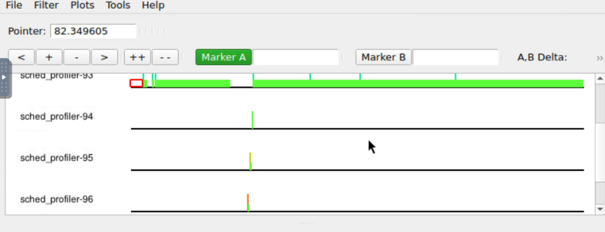
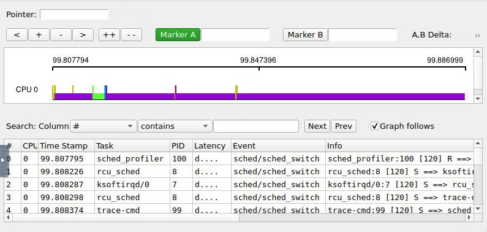
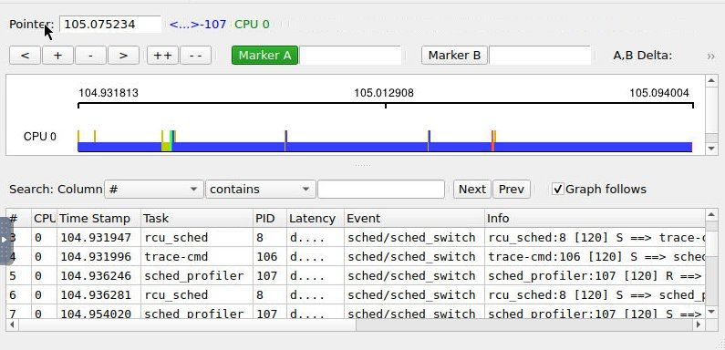
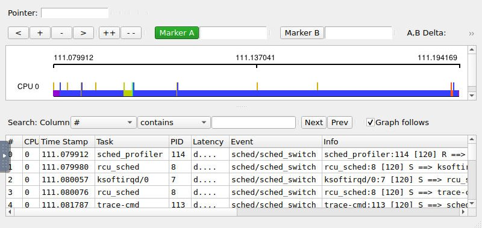

# Laboratório de Sistemas Operacionais: sched_profiler

## 1. Descrição do Trabalho
Este projeto implementa a aplicação multithread **`sched_profiler`**, desenvolvida para a disciplina de Laboratório de Sistemas Operacionais (Ciência da Computação - PUCRS).

O objetivo é avaliar empiricamente as características de escalonamento de processos no Linux (CFS, políticas de tempo real e políticas idle customizadas), observando a alternância de threads e o impacto de diferentes políticas em ambientes monoprocessados (mono-core) e multiprocessados.

---

## 2. Arquitetura da Aplicação

1. **Buffer Global e Ponteiro:**
   - A aplicação aloca dinamicamente um buffer contínuo em memória (`char *global_buffer`) com o tamanho especificado por parâmetro (`buffer_size`).
   - Um índice/ponteiro global compartilhado (`int global_index`) controla a posição corrente de escrita.

2. **Sincronização com Semáforo Binário:**
   - O acesso concorrente ao buffer e a atualização do ponteiro global são sincronizados estritamente através de um semáforo binário (`sem_t sem_buffer`), inicializado via `sem_init(&sem_buffer, 0, 1)`.
   - Cada thread executa `sem_wait(&sem_buffer)`, grava seu caractere identificador (`'A' + thread_id`), incrementa o índice global e libera a seção crítica através de `sem_post(&sem_buffer)`.

3. **Políticas de Escalonamento Suportadas:**
   - `SCHED_FIFO` (1): Tempo real (First In, First Out). Sem time-slice; a thread roda até terminar ou bloquear.
   - `SCHED_RR` (2): Tempo real com Round-Robin e quantum fixo de tempo.
   - `SCHED_OTHER` / `SCHED_NORMAL` (0): Escalonador padrão CFS do Linux.
   - `SCHED_IDLE` (5): Escalonador para tarefas de prioridade muito baixa (CFS weight 3).
   - `SCHED_LOW_IDLE` (7): Política customizada desenvolvida no Kernel 4.13.9 da disciplina (CFS weight 1), preemptada por todas as demais classes.

---

## 3. Parâmetros de Entrada e Execução

### Sintaxe
```bash
./sched_profiler <buffer_size> <num_threads> <policy> [--showpos | --showpre] [--record]
```

- `<buffer_size>`: Quantidade total de caracteres a serem escritos no buffer global (ex.: `10000`).
- `<num_threads>`: Quantidade de threads simultâneas a serem criadas (ex.: `4`).
- `<policy>`: Política de escalonamento a ser configurada nas threads (`SCHED_LOW_IDLE`, `SCHED_IDLE`, `SCHED_FIFO`, `SCHED_RR` ou `SCHED_OTHER`).
- `--showpos` (Padrão): Exibe diretamente a saída pós-processada (ordem compactada de rajadas e resumo por thread).
- `--showpre`: Exibe também o buffer bruto antes do pós-processamento (todas as letras geradas).
- `--record`: Dispara automaticamente a gravação de trace do kernel com `trace-cmd record -e sched:sched_switch` e salva em `/root/trace_<politica>.dat`.

### Exemplos de Execução

#### Modo Gravação Automática no QEMU (com `--record`):
```bash
sched_profiler 10000 4 SCHED_RR --record
sched_profiler 10000 4 SCHED_FIFO --record
sched_profiler 10000 4 SCHED_IDLE --record
sched_profiler 10000 4 SCHED_LOW_IDLE --record
```

#### Modo Manual (ou no Host via taskset):
```bash
taskset -c 0 ./sched_profiler 10000 4 SCHED_RR
taskset -c 0 ./sched_profiler 10000 4 SCHED_RR --showpre
```

---

## 4. Exemplos Reais de Saída do Programa

### 4.1. Execução Padrão (Modo `--showpos`):
```bash
./sched_profiler 10000 4 SCHED_RR
```

#### Saída real gerada no terminal:
```text
============================================================
   Laboratorio de Sistemas Operacionais - sched_profiler   
============================================================
Configuracao:
  Tamanho do Buffer:  10000 bytes
  Numero de Threads:  4
  Politica Escolhida: SCHED_RR (2)
============================================================

Saida apos pos-processamento:
ABDCABDCADBCA
A = 4
B = 3
C = 3
D = 3
```

### 4.2. Execução com `--showpre` (Exibindo o Buffer Bruto):
*(Exemplo com buffer de 100 bytes para visualização com quebra de 60 colunas)*
```bash
./sched_profiler 100 4 SCHED_OTHER --showpre
```

#### Saída real gerada no terminal:
```text
============================================================
   Laboratorio de Sistemas Operacionais - sched_profiler   
============================================================
Configuracao:
  Tamanho do Buffer:  100 bytes
  Numero de Threads:  4
  Politica Escolhida: SCHED_OTHER (0)
============================================================

Saida sem pos-processamento:
DDDDDDDDDDDDDDDDDDDDDDDDDDDDDDCCCCCCCCCCCCCCCCCCCCCCCCCCCCCC
CCCCCCCCCCBBBBBBBBBBBBBBBBBBBBBBBBBBBBBB

Saida apos pos-processamento:
DCB
A = 0
B = 1
C = 1
D = 1
```

> **Explicação do Pós-processamento:**
> O pós-processador agrega caracteres consecutivos idênticos, evidenciando as fatias de tempo em que cada thread manteve o controle da CPU. O contador quantifica quantas vezes cada thread obteve o processador (número de rajadas/bursts de CPU em que foi escalonada).

---

## 5. Captura com trace-cmd e Visualização no KernelShark

### 5.1. Capturando eventos no Guest (QEMU)
No QEMU (iniciado com `./run_qemu.sh` que já define `-smp cpus=1`):
```bash
# Exemplo para SCHED_RR:
trace-cmd record -e sched:sched_switch -o /root/trace_rr.dat ./sched_profiler 10000 4 SCHED_RR

# Exemplo para SCHED_FIFO:
trace-cmd record -e sched:sched_switch -o /root/trace_fifo.dat ./sched_profiler 10000 4 SCHED_FIFO

# Exemplo para SCHED_IDLE:
trace-cmd record -e sched:sched_switch -o /root/trace_idle.dat ./sched_profiler 10000 4 SCHED_IDLE

# Exemplo para SCHED_LOW_IDLE:
trace-cmd record -e sched:sched_switch -o /root/trace_low_idle.dat ./sched_profiler 10000 4 SCHED_LOW_IDLE
```

### 5.2. Exportando o arquivo .dat para o Host no Codespace
No terminal do Codespace (fora do QEMU), utilize `e2cp`:
```bash
# Copia o trace gerado:
e2cp buildroot/output/images/rootfs.ext2:/root/trace_rr.dat trace_rr.dat
e2cp buildroot/output/images/rootfs.ext2:/root/trace_fifo.dat trace_fifo.dat
```

### 5.3. Abrindo o KernelShark no Codespace
Para iniciar a interface gráfica do KernelShark no navegador:
```bash
curl -fsSL https://gist.githubusercontent.com/miguelxvr/3c123ef67611652af9d2e45eccb8fc0a/raw/ | bash -s -- start
```
Para encerrar a sessão:
```bash
curl -fsSL https://gist.githubusercontent.com/miguelxvr/3c123ef67611652af9d2e45eccb8fc0a/raw/ | bash -s -- stop
```

---

## 6. Análise Comparativa das Políticas no KernelShark

| Política | Comportamento Observado | Característica no KernelShark |
| :--- | :--- | :--- |
| **SCHED_FIFO** | A primeira thread que adquire o semáforo executa continuamente sem preempção por timer até que encerre ou sofra bloqueio estrito. | Longos blocos contínuos da mesma CPU para uma única thread antes de alternar. |
| **SCHED_RR** | Cada thread consome um quantum de tempo e sofre preempção periódica pelo escalonador em rodízio circular. | Alternância balanceada em fatias de tempo homogêneas entre as threads ativas. |
| **SCHED_IDLE** | Tarefas operam sob o CFS mas com peso estático 3, sendo preemptadas por qualquer outra tarefa do sistema. | Trocas de contexto frequentes compartilhando o tempo de processamento ocioso. |
| **SCHED_LOW_IDLE** | Política com peso 1 desenvolvida no kernel da disciplina, preemptada até mesmo por tarefas `SCHED_IDLE`. | Execução somente quando não houver qualquer outra demanda de processamento. |

### Capturas no KernelShark

#### 1. SCHED_RR (Round-Robin)


#### 2. SCHED_FIFO (First In, First Out)


#### 3. SCHED_IDLE


#### 4. SCHED_LOW_IDLE


---

## 7. Estrutura do Pacote de Entrega (`sched_profiler.zip`)
- `sched_profiler.c`: Código fonte C com implementação do semáforo binário e configuração de políticas.
- `Makefile`: Script de compilação com suporte a flags `-Wall -O2 -pthread`.
- `README.md`: Este relatório detalhado de instruções, parâmetros e saídas.
- `imagens/`: Capturas de tela dos traces gerados no KernelShark para as 4 políticas:
  - `trace_rr.png` (SCHED_RR)
  - `trace_fifo.png` (SCHED_FIFO)
  - `trace_idle.png` (SCHED_IDLE)
  - `trace_low_idle.png` (SCHED_LOW_IDLE)
